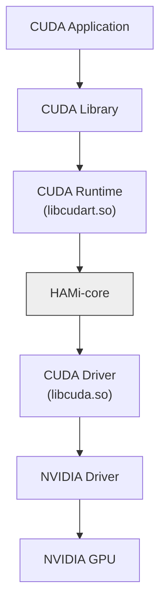

# HAMi-core: Hook library for CUDA Environments

[](https://github.com/Project-HAMi/HAMi-core/actions/workflows/build-src.yml)
[](https://github.com/Project-HAMi/HAMi-core/actions/workflows/style.yaml)

English | [中文](README_CN.md) | [日本語](README_JA.md)

HAMi-core is the in-container GPU resource controller. It intercepts CUDA calls to enforce per-container device memory limits and compute utilization limits, without requiring changes to the application or the driver. It has been adopted by [HAMi](https://github.com/Project-HAMi/HAMi) and [volcano](https://github.com/volcano-sh/devices). For the overall HAMi architecture and how HAMi-core fits into it, see the [HAMi project](https://github.com/Project-HAMi/HAMi).

- [Features](#features)
- [How it works](#how-it-works)
- [Getting started](#getting-started)
- [Usage](#usage)
- [Configuration](#configuration)
- [Docker](#docker)
- [Logging](#logging)
- [Testing](#testing)
- [Repository layout](#repository-layout)
- [Contributing](#contributing)

## Features

- **Device memory virtualization.** Each container sees and is held to its own memory limit, per device.
- **Compute limiting.** SM utilization is limited with a self-implemented time-sharing scheme.
- **Real-time utilization monitor.** Usage is tracked across all processes in the container through a shared region.


## How it works

HAMi-core hijacks the API calls between the CUDA runtime (`libcudart.so`) and the CUDA driver (`libcuda.so`), as shown below. It also hooks the matching NVML calls so that tools such as `nvidia-smi` report the limited view.



## Getting started

### Prerequisites

- Linux with glibc (x86_64 or aarch64)
- CMake >= 3.18
- A working CUDA toolkit, 12.x or 13.x (`CUDA_HOME`, default `/usr/local/cuda`)
- Docker, if you prefer the containerized build

### Build in Docker

```bash
make build-in-docker
```

This builds `libvgpu.so` and runs the CPU-only tests with `ctest`.

### Build locally

```bash
./build.sh
```

The resulting `libvgpu.so` is written to the `build/` directory.

## Usage

Preload the library and set the limits through environment variables:

```bash
# Limit every device to 1 GiB of memory and 50% of the SMs
export LD_PRELOAD=./libvgpu.so
export CUDA_DEVICE_MEMORY_LIMIT=1g
export CUDA_DEVICE_SM_LIMIT=50
```

If you run CUDA applications locally, create the lock directory first:

```bash
mkdir /tmp/vgpulock/
```

Limits are stored in a shared cache file. If you change `CUDA_DEVICE_MEMORY_LIMIT` or `CUDA_DEVICE_SM_LIMIT`, delete it before the next run:

```bash
rm /tmp/cudevshr.cache
```

## Configuration

| Variable | Description |
| -------- | ----------- |
| `CUDA_DEVICE_MEMORY_LIMIT` | Device memory limit for all devices, for example `1g`, `1024m`, `1048576k` or `1073741824`. Units are `K`, `M` and `G` (also `Ki`, `KB`, `KiB`), 1024 based. `0` or unset means no limit. |
| `CUDA_DEVICE_MEMORY_LIMIT_<n>` | Memory limit for device `n`, overriding `CUDA_DEVICE_MEMORY_LIMIT`. |
| `CUDA_DEVICE_SM_LIMIT` | SM utilization limit in percent, for example `50` or `50%`. `0` or unset means no limit. |
| `CUDA_DEVICE_SM_LIMIT_<n>` | SM limit for device `n`, overriding `CUDA_DEVICE_SM_LIMIT`. |
| `GPU_CORE_UTILIZATION_POLICY` | `force` always applies the SM limit and `disable` turns it off. Unset keeps the default behavior. |
| `CUDA_DEVICE_MEMORY_SHARED_CACHE` | Path of the shared cache file (default `/tmp/cudevshr.cache`). |
| `CUDA_VISIBLE_DEVICES` | Honored when mapping CUDA device indexes to physical devices. |
| `CUDA_REDIRECT` | Path of `libvgpu.so` to load when intercepting `dlsym` (default `/usr/local/vgpu/libvgpu.so`). |
| `RECORD_KERNEL_INTERVAL` | Minimum number of seconds between recording kernel launch times (default `1`). |
| `LIBCUDA_LOG_LEVEL` | Log verbosity, see [Logging](#logging). |

Up to 16 devices are supported per container.

## Docker

```bash
# Build docker image
docker build . -f=dockerfiles/Dockerfile -t hami-core:dev

# Configure GPU device and library mounts for container
export DEVICE_MOUNTS="--device /dev/nvidia0:/dev/nvidia0 --device /dev/nvidia-uvm:/dev/nvidia-uvm --device /dev/nvidiactl:/dev/nvidiactl"
export LIBRARY_MOUNTS="-v /usr/cuda_files:/usr/cuda_files -v $(which nvidia-smi):/bin/nvidia-smi"

# Run container and check nvidia-smi output
docker run ${LIBRARY_MOUNTS} ${DEVICE_MOUNTS} -it \
    -e CUDA_DEVICE_MEMORY_LIMIT=2g \
    -e LD_PRELOAD=/libvgpu/build/libvgpu.so \
    hami-core:dev \
    nvidia-smi
```

After running, you will see `nvidia-smi` output similar to the following, showing memory limited to 2 GiB:

```
...
[HAMI-core Msg(1:140235494377280:libvgpu.c:836)]: Initializing.....
Mon Dec  2 04:38:12 2024
+-----------------------------------------------------------------------------------------+
| NVIDIA-SMI 550.107.02             Driver Version: 550.107.02     CUDA Version: 12.4     |
|-----------------------------------------+------------------------+----------------------+
| GPU  Name                 Persistence-M | Bus-Id          Disp.A | Volatile Uncorr. ECC |
| Fan  Temp   Perf          Pwr:Usage/Cap |           Memory-Usage | GPU-Util  Compute M. |
|                                         |                        |               MIG M. |
|=========================================+========================+======================|
|   0  NVIDIA GeForce RTX 3060        Off |   00000000:03:00.0 Off |                  N/A |
| 30%   36C    P8              7W /  170W |       0MiB /   2048MiB |      0%      Default |
|                                         |                        |                  N/A |
+-----------------------------------------+------------------------+----------------------+

+-----------------------------------------------------------------------------------------+
| Processes:                                                                              |
|  GPU   GI   CI        PID   Type   Process name                              GPU Memory |
|        ID   ID                                                               Usage      |
|=========================================================================================|
+-----------------------------------------------------------------------------------------+
[HAMI-core Msg(1:140235494377280:multiprocess_memory_limit.c:497)]: Calling exit handler 1
```

## Logging

Use the environment variable `LIBCUDA_LOG_LEVEL` to set the visibility of logs:

| LIBCUDA_LOG_LEVEL | Description |
| ----------------- | ----------- |
| 0 | errors only |
| 1 (default), 2 | errors, warnings, messages |
| 3 | infos, errors, warnings, messages |
| 4 | debugs, errors, warnings, messages |

## Testing

The tests are built together with the library. Most of them need no GPU:

```bash
./build.sh
ctest --test-dir build --output-on-failure
```

Tests that allocate device memory need a GPU and `libvgpu.so`. Run them directly from `build/test/`, for example:

```bash
./build/test/test_alloc
```

Before opening a pull request, also run the static hook check that CI runs:

```bash
make check-cuda-hook-consistency
```

## Repository layout

| Path | Contents |
| ---- | -------- |
| `src/cuda/` | Hooked CUDA driver and runtime entry points |
| `src/nvml/` | Hooked NVML entry points |
| `src/allocator/` | Device memory tracking |
| `src/multiprocess/` | Shared region, memory accounting and the utilization watcher |
| `src/include/` | Headers, including the hook tables |
| `test/` | Unit tests and GPU tests |
| `hack/` | Repository checks |
| `dockerfiles/` | Build image |

## Contributing

Contributions are welcome. See [CONTRIBUTING.md](CONTRIBUTING.md) for the contribution workflow, code of conduct, and review process before opening a pull request.

## License

HAMi-core is licensed under the Apache License 2.0. See [LICENSE](LICENSE).
