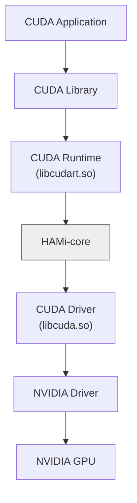

# HAMi-core: CUDA 环境的 Hook 库

[](https://github.com/Project-HAMi/HAMi-core/actions/workflows/build-src.yml)
[](https://github.com/Project-HAMi/HAMi-core/actions/workflows/style.yaml)

[English](README.md) | 中文 | [日本語](README_JA.md)

HAMi-core 是一个容器内的 GPU 资源控制器，在不修改应用或驱动的前提下，通过拦截 CUDA 调用来实现按容器的设备显存限制和算力限制。已被 [HAMi](https://github.com/Project-HAMi/HAMi) 和 [volcano](https://github.com/volcano-sh/devices) 等项目采用。关于 HAMi 整体架构以及 HAMi-core 在其中的位置，请参阅 [HAMi 项目](https://github.com/Project-HAMi/HAMi)。

- [特性](#特性)
- [设计原理](#设计原理)
- [快速开始](#快速开始)
- [使用方法](#使用方法)
- [配置项](#配置项)
- [Docker](#docker)
- [日志](#日志)
- [测试](#测试)
- [目录结构](#目录结构)
- [参与贡献](#参与贡献)

## 特性

- **显存虚拟化。** 每个容器看到并受限于各自的显存上限，按设备生效。
- **算力限制。** 通过自实现的时间片方式限制 SM 利用率。
- **实时利用率监控。** 通过共享内存区域统计容器内所有进程的使用情况。


## 设计原理

HAMi-core 通过劫持 CUDA-Runtime(`libcudart.so`) 和 CUDA-Driver(`libcuda.so`) 之间的 API 调用来实现功能，如下图所示。同时它也会 hook 对应的 NVML 调用，使 `nvidia-smi` 等工具显示受限后的视图。



## 快速开始

### 环境依赖

- 使用 glibc 的 Linux（x86_64 或 aarch64）
- CMake >= 3.18
- 可用的 CUDA 工具链，12.x 或 13.x（`CUDA_HOME`，默认 `/usr/local/cuda`）
- 如需容器化编译，还需要 Docker

### 在 Docker 中编译

```bash
make build-in-docker
```

该命令会编译 `libvgpu.so`，并使用 `ctest` 运行无需 GPU 的测试。

### 本地编译

```bash
./build.sh
```

编译产物 `libvgpu.so` 会写入 `build/` 目录。

## 使用方法

预加载该库，并通过环境变量设置限制：

```bash
# 为所有设备添加 1GiB 显存限制，并将最大 SM 利用率设置为 50%
export LD_PRELOAD=./libvgpu.so
export CUDA_DEVICE_MEMORY_LIMIT=1g
export CUDA_DEVICE_SM_LIMIT=50
```

如果在本地运行 CUDA 应用，请先创建锁目录：

```bash
mkdir /tmp/vgpulock/
```

限制值保存在共享缓存文件中。如果修改了 `CUDA_DEVICE_MEMORY_LIMIT` 或 `CUDA_DEVICE_SM_LIMIT`，请在下次运行前删除该文件：

```bash
rm /tmp/cudevshr.cache
```

## 配置项

| 变量 | 说明 |
| ---- | ---- |
| `CUDA_DEVICE_MEMORY_LIMIT` | 所有设备的显存上限，例如 `1g`、`1024m`、`1048576k` 或 `1073741824`。单位为 `K`、`M`、`G`（也可写作 `Ki`、`KB`、`KiB`），按 1024 进制。`0` 或未设置表示不限制。 |
| `CUDA_DEVICE_MEMORY_LIMIT_<n>` | 第 `n` 号设备的显存上限，优先于 `CUDA_DEVICE_MEMORY_LIMIT`。 |
| `CUDA_DEVICE_SM_LIMIT` | SM 利用率上限（百分比），例如 `50` 或 `50%`。`0` 或未设置表示不限制。 |
| `CUDA_DEVICE_SM_LIMIT_<n>` | 第 `n` 号设备的 SM 上限，优先于 `CUDA_DEVICE_SM_LIMIT`。 |
| `GPU_CORE_UTILIZATION_POLICY` | `force` 始终应用 SM 限制，`disable` 关闭 SM 限制。未设置时保持默认行为。 |
| `CUDA_DEVICE_MEMORY_SHARED_CACHE` | 共享缓存文件路径（默认 `/tmp/cudevshr.cache`）。 |
| `CUDA_VISIBLE_DEVICES` | 在将 CUDA 设备编号映射到物理设备时生效。 |
| `CUDA_REDIRECT` | 拦截 `dlsym` 时加载的 `libvgpu.so` 路径（默认 `/usr/local/vgpu/libvgpu.so`）。 |
| `RECORD_KERNEL_INTERVAL` | 记录 kernel 启动时间的最小间隔，单位为秒（默认 `1`）。 |
| `LIBCUDA_LOG_LEVEL` | 日志级别，见[日志](#日志)。 |

每个容器最多支持 16 个设备。

## Docker

```bash
# 构建 Docker 镜像
docker build . -f=dockerfiles/Dockerfile -t hami-core:dev

# 配置容器的 GPU 设备和库挂载
export DEVICE_MOUNTS="--device /dev/nvidia0:/dev/nvidia0 --device /dev/nvidia-uvm:/dev/nvidia-uvm --device /dev/nvidiactl:/dev/nvidiactl"
export LIBRARY_MOUNTS="-v /usr/cuda_files:/usr/cuda_files -v $(which nvidia-smi):/bin/nvidia-smi"

# 运行容器并检查 nvidia-smi 输出
docker run ${LIBRARY_MOUNTS} ${DEVICE_MOUNTS} -it \
    -e CUDA_DEVICE_MEMORY_LIMIT=2g \
    -e LD_PRELOAD=/libvgpu/build/libvgpu.so \
    hami-core:dev \
    nvidia-smi
```

运行后，你将看到类似如下的 `nvidia-smi` 输出，显示内存被限制为 2GiB：

```
...
[HAMI-core Msg(1:140235494377280:libvgpu.c:836)]: Initializing.....
Mon Dec  2 04:38:12 2024
+-----------------------------------------------------------------------------------------+
| NVIDIA-SMI 550.107.02             Driver Version: 550.107.02     CUDA Version: 12.4     |
|-----------------------------------------+------------------------+----------------------+
| GPU  Name                 Persistence-M | Bus-Id          Disp.A | Volatile Uncorr. ECC |
| Fan  Temp   Perf          Pwr:Usage/Cap |           Memory-Usage | GPU-Util  Compute M. |
|                                         |                        |               MIG M. |
|=========================================+========================+======================|
|   0  NVIDIA GeForce RTX 3060        Off |   00000000:03:00.0 Off |                  N/A |
| 30%   36C    P8              7W /  170W |       0MiB /   2048MiB |      0%      Default |
|                                         |                        |                  N/A |
+-----------------------------------------+------------------------+----------------------+

+-----------------------------------------------------------------------------------------+
| Processes:                                                                              |
|  GPU   GI   CI        PID   Type   Process name                              GPU Memory |
|        ID   ID                                                               Usage      |
|=========================================================================================|
+-----------------------------------------------------------------------------------------+
[HAMI-core Msg(1:140235494377280:multiprocess_memory_limit.c:497)]: Calling exit handler 1
```

## 日志

使用环境变量 `LIBCUDA_LOG_LEVEL` 设置日志的可见级别：

| LIBCUDA_LOG_LEVEL | 说明 |
| ----------------- | ---- |
| 0 | 仅错误 |
| 1（默认）, 2 | 错误、警告、消息 |
| 3 | 信息、错误、警告、消息 |
| 4 | 调试、错误、警告、消息 |

## 测试

测试与库一起编译，大部分无需 GPU：

```bash
./build.sh
ctest --test-dir build --output-on-failure
```

需要分配设备显存的测试需要 GPU 和 `libvgpu.so`，请直接从 `build/test/` 运行，例如：

```bash
./build/test/test_alloc
```

提交 Pull Request 之前，还请运行 CI 中的静态 hook 检查：

```bash
make check-cuda-hook-consistency
```

## 目录结构

| 路径 | 内容 |
| ---- | ---- |
| `src/cuda/` | 被 hook 的 CUDA 驱动和运行时入口 |
| `src/nvml/` | 被 hook 的 NVML 入口 |
| `src/allocator/` | 设备显存跟踪 |
| `src/multiprocess/` | 共享区域、显存统计和利用率监控 |
| `src/include/` | 头文件，包含 hook 表 |
| `test/` | 单元测试和 GPU 测试 |
| `hack/` | 仓库检查脚本 |
| `dockerfiles/` | 编译镜像 |

## 参与贡献

欢迎贡献。提交 Pull Request 之前，请阅读 [CONTRIBUTING.md](CONTRIBUTING.md)，了解贡献流程、行为准则和评审流程。

## 许可证

HAMi-core 使用 Apache License 2.0 许可证，详见 [LICENSE](LICENSE)。
