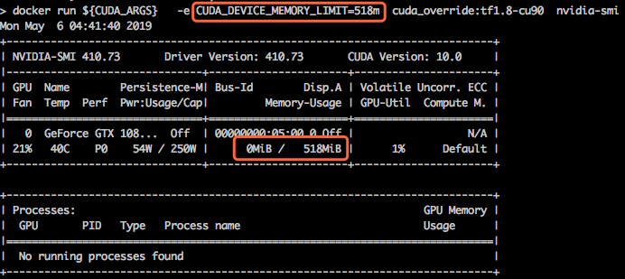
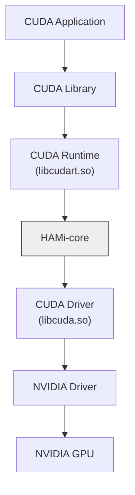

# HAMi-core: CUDA環境向けフックライブラリ

[](https://github.com/Project-HAMi/HAMi-core/actions/workflows/build-src.yml)
[](https://github.com/Project-HAMi/HAMi-core/actions/workflows/style.yaml)

[English](README.md) | [中文](README_CN.md) | 日本語

HAMi-coreはコンテナ内のGPUリソースコントローラーです。アプリケーションやドライバーを変更することなく、CUDA呼び出しをインターセプトして、コンテナごとのデバイスメモリ制限と計算使用率の制限を実現します。[HAMi](https://github.com/Project-HAMi/HAMi)や[volcano](https://github.com/volcano-sh/devices)などで採用されています。HAMi全体のアーキテクチャとHAMi-coreの位置づけについては、[HAMiプロジェクト](https://github.com/Project-HAMi/HAMi)を参照してください。

- [機能](#機能)
- [設計](#設計)
- [はじめ方](#はじめ方)
- [使用方法](#使用方法)
- [設定](#設定)
- [Docker](#docker)
- [ログ](#ログ)
- [テスト](#テスト)
- [ディレクトリ構成](#ディレクトリ構成)
- [コントリビューション](#コントリビューション)

## 機能

- **デバイスメモリの仮想化。** 各コンテナは、デバイスごとに自分のメモリ上限だけを参照し、その範囲に制限されます。
- **計算リソースの制限。** 独自実装のタイムシェアリング方式でSM使用率を制限します。
- **リアルタイムのデバイス使用率モニター。** 共有リージョンを通じて、コンテナ内の全プロセスの使用状況を追跡します。



## 設計

HAMi-coreは、以下の図のとおり、CUDAランタイム(`libcudart.so`)とCUDAドライバー(`libcuda.so`)間のAPI呼び出しをフックします。対応するNVML呼び出しもフックするため、`nvidia-smi`などのツールにも制限後の情報が表示されます。



## はじめ方

### 前提条件

- glibcを使用するLinux（x86_64またはaarch64）
- CMake >= 3.18
- 有効なCUDAツールチェーン、12.xまたは13.x（`CUDA_HOME`、デフォルトは`/usr/local/cuda`）
- コンテナ化ビルドを行う場合はDockerも必要

### Dockerでのビルド

```bash
make build-in-docker
```

`libvgpu.so`をビルドし、GPU不要のテストを`ctest`で実行します。

### ローカルビルド

```bash
./build.sh
```

ビルド成果物`libvgpu.so`は`build/`ディレクトリに出力されます。

## 使用方法

ライブラリをプリロードし、環境変数で制限を設定します。

```bash
# すべてのデバイスに1GiBのメモリ制限を設定し、最大SM使用率を50%にする
export LD_PRELOAD=./libvgpu.so
export CUDA_DEVICE_MEMORY_LIMIT=1g
export CUDA_DEVICE_SM_LIMIT=50
```

CUDAアプリケーションをローカルで実行する場合は、先にロック用ディレクトリを作成してください。

```bash
mkdir /tmp/vgpulock/
```

制限値は共有キャッシュファイルに保存されます。`CUDA_DEVICE_MEMORY_LIMIT`または`CUDA_DEVICE_SM_LIMIT`を変更した場合は、次回の実行前にこのファイルを削除してください。

```bash
rm /tmp/cudevshr.cache
```

## 設定

| 変数 | 説明 |
| ---- | ---- |
| `CUDA_DEVICE_MEMORY_LIMIT` | 全デバイスのメモリ上限。例：`1g`、`1024m`、`1048576k`、`1073741824`。単位は`K`、`M`、`G`（`Ki`、`KB`、`KiB`も可）で、1024進数です。`0`または未設定の場合は無制限です。 |
| `CUDA_DEVICE_MEMORY_LIMIT_<n>` | デバイス`n`のメモリ上限。`CUDA_DEVICE_MEMORY_LIMIT`より優先されます。 |
| `CUDA_DEVICE_SM_LIMIT` | SM使用率の上限（パーセント）。例：`50`、`50%`。`0`または未設定の場合は無制限です。 |
| `CUDA_DEVICE_SM_LIMIT_<n>` | デバイス`n`のSM上限。`CUDA_DEVICE_SM_LIMIT`より優先されます。 |
| `GPU_CORE_UTILIZATION_POLICY` | `force`は常にSM制限を適用し、`disable`は無効にします。未設定の場合はデフォルトの動作です。 |
| `CUDA_DEVICE_MEMORY_SHARED_CACHE` | 共有キャッシュファイルのパス（デフォルトは`/tmp/cudevshr.cache`）。 |
| `CUDA_VISIBLE_DEVICES` | CUDAデバイス番号を物理デバイスに対応付ける際に参照されます。 |
| `CUDA_REDIRECT` | `dlsym`をインターセプトする際にロードする`libvgpu.so`のパス（デフォルトは`/usr/local/vgpu/libvgpu.so`）。 |
| `RECORD_KERNEL_INTERVAL` | カーネル起動時刻を記録する最小間隔（秒、デフォルトは`1`）。 |
| `LIBCUDA_LOG_LEVEL` | ログの詳細度。[ログ](#ログ)を参照してください。 |

1コンテナあたり最大16デバイスをサポートします。

## Docker

```bash
# Dockerイメージのビルド
docker build . -f=dockerfiles/Dockerfile -t hami-core:dev

# コンテナ用のGPUデバイスとライブラリのマウントを設定
export DEVICE_MOUNTS="--device /dev/nvidia0:/dev/nvidia0 --device /dev/nvidia-uvm:/dev/nvidia-uvm --device /dev/nvidiactl:/dev/nvidiactl"
export LIBRARY_MOUNTS="-v /usr/cuda_files:/usr/cuda_files -v $(which nvidia-smi):/bin/nvidia-smi"

# コンテナを実行してnvidia-smiの出力を確認
docker run ${LIBRARY_MOUNTS} ${DEVICE_MOUNTS} -it \
    -e CUDA_DEVICE_MEMORY_LIMIT=2g \
    -e LD_PRELOAD=/libvgpu/build/libvgpu.so \
    hami-core:dev \
    nvidia-smi
```

実行後、以下のような`nvidia-smi`の出力が表示され、メモリが2GiBに制限されていることが確認できます。

```
...
[HAMI-core Msg(1:140235494377280:libvgpu.c:836)]: Initializing.....
Mon Dec  2 04:38:12 2024
+-----------------------------------------------------------------------------------------+
| NVIDIA-SMI 550.107.02             Driver Version: 550.107.02     CUDA Version: 12.4     |
|-----------------------------------------+------------------------+----------------------+
| GPU  Name                 Persistence-M | Bus-Id          Disp.A | Volatile Uncorr. ECC |
| Fan  Temp   Perf          Pwr:Usage/Cap |           Memory-Usage | GPU-Util  Compute M. |
|                                         |                        |               MIG M. |
|=========================================+========================+======================|
|   0  NVIDIA GeForce RTX 3060        Off |   00000000:03:00.0 Off |                  N/A |
| 30%   36C    P8              7W /  170W |       0MiB /   2048MiB |      0%      Default |
|                                         |                        |                  N/A |
+-----------------------------------------+------------------------+----------------------+

+-----------------------------------------------------------------------------------------+
| Processes:                                                                              |
|  GPU   GI   CI        PID   Type   Process name                              GPU Memory |
|        ID   ID                                                               Usage      |
|=========================================================================================|
+-----------------------------------------------------------------------------------------+
[HAMI-core Msg(1:140235494377280:multiprocess_memory_limit.c:497)]: Calling exit handler 1
```

## ログ

環境変数`LIBCUDA_LOG_LEVEL`でログの表示レベルを設定します。

| LIBCUDA_LOG_LEVEL | 説明 |
| ----------------- | ---- |
| 0 | エラーのみ |
| 1（デフォルト）, 2 | エラー、警告、メッセージ |
| 3 | 情報、エラー、警告、メッセージ |
| 4 | デバッグ、エラー、警告、メッセージ |

## テスト

テストはライブラリと一緒にビルドされ、ほとんどはGPUを必要としません。

```bash
./build.sh
(cd build && ctest --output-on-failure)
```

デバイスメモリを確保するテストにはGPUと`libvgpu.so`が必要です。`build/test/`から直接実行してください。例：

```bash
./build/test/test_alloc
```

プルリクエストを作成する前に、CIで実行される静的フックチェックも実行してください。

```bash
make check-cuda-hook-consistency
```

## ディレクトリ構成

| パス | 内容 |
| ---- | ---- |
| `src/cuda/` | フックされるCUDAドライバーとランタイムのエントリポイント |
| `src/nvml/` | フックされるNVMLのエントリポイント |
| `src/allocator/` | デバイスメモリの追跡 |
| `src/multiprocess/` | 共有リージョン、メモリ集計、使用率ウォッチャー |
| `src/include/` | フックテーブルを含むヘッダー |
| `test/` | ユニットテストとGPUテスト |
| `hack/` | リポジトリのチェック用スクリプト |
| `dockerfiles/` | ビルド用イメージ |

## コントリビューション

コントリビューションを歓迎します。プルリクエストを作成する前に、コントリビューションのワークフロー、行動規範、レビュープロセスについて[CONTRIBUTING.md](CONTRIBUTING.md)を参照してください。

## ライセンス

HAMi-coreはApache License 2.0の下でライセンスされています。詳細は[LICENSE](LICENSE)を参照してください。
